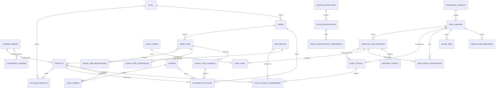

# Arquitetura do motor de cardapio, ficha tecnica, estoque, vendas e rentabilidade

## 1. Resumo executivo

O sistema deve evoluir de um cadastro de itens vendidos para um motor transacional que conecta cardapio, ficha tecnica, estoque, venda, custo, CMV, margem e tomada de decisao.

Decisao central:

> O cardapio define o que e vendido. A ficha tecnica define o que e consumido. A venda preserva quanto foi cobrado, quanto foi consumido e quanto custou naquele momento.

O primeiro fluxo vertical deve provar, ponta a ponta:

1. compra de ingredientes;
2. custo medio atualizado;
3. item e variacao cadastrados;
4. ficha tecnica publicada;
5. custo e capacidade consultados;
6. venda finalizada;
7. ingredientes baixados;
8. snapshot financeiro salvo;
9. cancelamento com estorno;
10. nova ficha publicada sem alterar venda antiga.

Recomendacao arquitetural:

- monolito modular em Spring Boot;
- PostgreSQL como banco preferencial;
- Flyway para migrations;
- BigDecimal em dinheiro, quantidade, custo e percentual;
- movimentacao de estoque imutavel;
- ficha tecnica versionada;
- venda com snapshot hibrido: tabelas relacionais para consulta critica e JSON para auditoria de payload calculado;
- finalizacao de venda com `@Transactional`, idempotency key e bloqueio pessimista/atualizacao atomica de estoque no MVP.

O MVP nao deve tentar resolver tudo. Ele deve entregar o fluxo vertical completo com ingredientes, ficha, venda, baixa, snapshot e estorno. Meio a meio, combos complexos, producao intermediaria armazenada e recomendacoes inteligentes entram depois.

## 2. Visao de negocio

O restaurante precisa responder perguntas operacionais e financeiras sem planilhas paralelas:

- Posso vender este item agora?
- Quantas unidades ainda consigo produzir?
- Qual ingrediente limita a producao?
- Quanto custou a venda no momento em que ocorreu?
- Qual CMV do item, categoria, canal e periodo?
- Qual preco recomendado para atingir CMV alvo?
- Qual item vende muito mas deixa pouca margem?
- Qual alteracao de ficha ou fornecedor afetou a rentabilidade?

Metas de produto:

- reduzir ruptura no PDV;
- evitar venda sem estoque;
- preservar historico financeiro confiavel;
- melhorar compras com base em consumo real/teorico;
- permitir engenharia de cardapio explicavel;
- permitir auditoria de preco, ficha, custo, venda, estorno e estoque.

Indicadores de negocio:

- CMV por item, categoria e canal;
- margem de contribuicao unitaria e total;
- capacidade produtiva atual;
- ingredientes limitantes;
- desperdicio e perdas;
- itens pausados/esgotados;
- divergencia teorico versus real;
- recomendacoes explicaveis.

## 3. Principios arquiteturais

1. Historico nao muda.
   Preco, custo, ficha, modificadores e composicao devem ser preservados na venda.

2. Estoque nunca muda silenciosamente.
   Toda alteracao gera `MovimentoEstoque` imutavel.

3. Frontend melhora experiencia; backend e fonte da verdade.
   PDV pode calcular previa, mas preco final, custo, disponibilidade e baixa sao validados no backend.

4. Receita publicada e imutavel.
   Alteracao cria nova versao. Venda guarda versao usada.

5. Dinheiro e quantidade usam BigDecimal.
   Nunca usar `double` ou `float`.

6. Estoque usa unidade base canonica por produto.
   Entrada, receita e venda podem usar unidades diferentes, mas persistencia operacional usa quantidade normalizada em unidade base.

7. Movimentos sao reversiveis por compensacao, nao por delecao.
   Estorno cria movimento inverso vinculado ao movimento original.

8. Idempotencia e obrigatoria em finalizacao/cancelamento.
   Clique duplicado ou retry nao pode baixar estoque duas vezes.

9. Consistencia transacional primeiro; eventos depois.
   Venda e baixa devem confirmar juntas. Relatorios, alertas e caches podem ser assíncronos.

10. Regras de negocio ficam em servicos de dominio, nao em controllers.

## 4. Mapa dos modulos

| Modulo | Responsabilidade | Comunica com |
|---|---|---|
| cardapio | Item comercial, categoria, variacao, canal, status | ficha, PDV, venda |
| modificadores | Grupos, opcoes, regras e impactos | cardapio, ficha, venda |
| ficha tecnica | Receita versionada, ingredientes, rendimento, custo | produto, estoque, rentabilidade |
| sub-receitas | Preparos intermediarios teoricos ou produzidos | ficha, estoque, producao |
| unidades | Unidades, dimensoes e conversoes | produto, compra, ficha, estoque |
| produtos | Ingredientes e itens de estoque | compra, estoque, ficha |
| estoque | saldos, reservas, movimentos, lotes | venda, compra, producao |
| compras | entrada fiscal/compra, fornecedores, custo | produto, estoque, financeiro |
| vendas | pedido, itens, pagamento, snapshot | cardapio, estoque, rentabilidade |
| canais | salao, delivery, marketplace, taxas e precos | venda, rentabilidade |
| disponibilidade | status real, horarios, pausas, estoque, capacidade | cardapio, estoque, PDV |
| rentabilidade | CMV, margem, contribuicao, engenharia | venda, ficha, compra |
| simulacao | preco, receita, custo e impacto | ficha, produto, canal |
| auditoria | trilha persistente e consultavel | todos |
| usuarios/permissoes | autenticacao/autorizacao | controllers e app services |

Comunicacao recomendada no monolito:

- controller chama application service;
- application service orquestra servicos de dominio;
- servicos de dominio usam repositories e value objects;
- eventos de dominio alimentam auditoria, projecoes e alertas.

## 5. Fluxo completo de uma venda

Fluxo operacional:

1. Criar pedido/venda em rascunho.
2. Adicionar item do cardapio.
3. Selecionar variacao.
4. Selecionar grupos/modificadores.
5. Backend valida item, variacao, canal, horario e modificadores.
6. `MontagemItemVendaService` monta composicao final:
   - ficha base;
   - ficha da variacao;
   - efeitos dos modificadores;
   - proporcoes especiais, como meio a meio;
   - embalagem e custos de canal.
7. `CalculadoraDisponibilidadeService` consulta disponibilidade.
8. Se pedido vai para cozinha, reservar estoque opcionalmente.
9. Ao finalizar pagamento, `FinalizacaoVendaService` abre transacao.
10. Revalida preco, disponibilidade e idempotencia.
11. Bloqueia/atualiza saldos dos produtos consumidos.
12. Cria movimentos de estoque.
13. Salva `Venda`, `VendaItem`, `VendaItemConsumo`, modificadores e snapshots.
14. Salva custos variaveis, margem e CMV.
15. Confirma pagamento/venda.
16. Publica eventos para auditoria, relatorios, alertas e cache.

Momentos do estoque:

| Estado | Acao de estoque |
|---|---|
| pedido em rascunho | apenas validar ou calcular previa |
| item enviado a cozinha | reservar, se o restaurante precisar controlar capacidade em producao |
| pagamento confirmado/finalizacao | baixar efetivamente |
| pagamento falhou | liberar reserva |
| item removido antes de confirmar | liberar reserva |
| venda cancelada depois de finalizada | criar movimentos de estorno |
| cancelamento parcial | estornar apenas consumos do item |

MVP recomendado:

- sem reserva no rascunho;
- baixa transacional apenas na finalizacao;
- estorno por movimento inverso;
- idempotency key em `POST /vendas/{id}/finalizar`.

## 6. Modelo de dominio

Agregados principais:

- `ItemCardapio`: raiz comercial. Define nome, categoria, status, canais, imagens e variacoes.
- `VariacaoItemCardapio`: opcao vendavel concreta, como grande/broto/duplo.
- `FichaTecnica`: versao de receita publicada ou rascunho.
- `Produto`: ingrediente ou item de estoque.
- `EstoqueProduto`: saldo operacional por filial/produto/lote opcional.
- `Venda`: raiz transacional de venda/pedido.
- `VendaItem`: item vendido com snapshot comercial.
- `VendaItemConsumo`: consumo calculado e custo congelado.
- `MovimentoEstoque`: ledger imutavel.
- `Compra`: entrada e origem de custo.
- `Auditoria`: trilha persistente.

Value objects recomendados:

- `Dinheiro(valor, moeda)`;
- `Quantidade(valor, unidadeId)`;
- `Percentual(valor)`;
- `PeriodoVigencia(inicio, fim)`;
- `CustoUnitario(valor, unidadeBase)`;
- `Preco(valor)`;
- `Margem(valor)`.

Entidades devem validar invariantes locais. Servicos de dominio validam regras que envolvem multiplos agregados.

Exemplo:

- `FichaTecnica.publicar()` valida status e metadata;
- `PublicacaoFichaTecnicaService` valida grafo, ingrediente, unidade, custo e vigencia.

## 7. Entidades e relacionamentos

Tipos sugeridos:

- dinheiro: `numeric(19,4)` para calculos intermediarios; `numeric(19,2)` para valores monetarios exibidos/fiscais;
- quantidades: `numeric(19,6)` ou `numeric(19,8)` conforme precisao;
- percentuais: `numeric(9,4)`;
- IDs: `bigserial` em tabelas transacionais, `bigint`.

### Entidades principais

| Entidade | Responsabilidade | Campos principais | Relacionamentos e constraints |
|---|---|---|---|
| `filial` | unidade operacional | id, nome, codigo, ativo | unique(codigo), soft delete |
| `usuario` | identidade | id/ru, nome, perfil, ativo | permissoes por papel |
| `unidade_medida` | unidade configuravel | id, codigo, nome, dimensao, escala | unique(codigo), check dimensao |
| `conversao_unidade` | conversao entre unidades compativeis | unidade_origem, unidade_destino, fator | unique(origem,destino), check fator>0 |
| `produto` | ingrediente/item de estoque | codigo, nome, unidade_base_id, custo_medio, ultimo_custo, politica_falta, perecivel, lote_obrigatorio | unique(codigo), FK unidade |
| `estoque_produto` | saldo por filial/produto/lote | produto_id, filial_id, lote_id, qtd_atual, qtd_reservada, versao | unique(produto,filial,lote), check saldos>=0 quando politica bloquear |
| `movimento_estoque` | ledger imutavel | produto, tipo, qtd, unidade_base, saldo_ant, saldo_pos, custo_unitario, origem, origem_id, idempotency_key | unique(idempotency_key), FK produto |
| `categoria_cardapio` | agrupamento visual | codigo, nome, ordem, ativo | unique(codigo) |
| `item_cardapio` | item comercial | codigo, nome, descricao, categoria, ativo, tipo, imagem, tags_json | unique(codigo), FK categoria |
| `variacao_item_cardapio` | unidade vendavel | item_id, codigo, nome, preco_base, ordem, ativo, tempo_preparo | unique(item_id,codigo) |
| `canal_venda` | canal comercial | codigo, nome, comissao_pct, taxa_fixa, ativo | unique(codigo) |
| `item_canal` | preco/disponibilidade por canal | variacao_id, canal_id, preco, ativo, comissao_override | unique(variacao,canal) |
| `grupo_modificador` | grupo de escolhas | codigo, nome, obrigatorio, min, max, permite_repeticao | unique(codigo) |
| `item_grupo_modificador` | grupo aplicado a variacao/item | item_id, variacao_id, grupo_id, ordem, regras_json | unique(escopo,grupo) |
| `opcao_modificador` | opcao selecionavel | grupo_id, codigo, nome, delta_preco, ativo, padrao | unique(grupo,codigo) |
| `opcao_modificador_componente` | impacto de estoque da opcao | opcao_id, tipo_efeito, produto_id, quantidade, unidade_id, alvo_codigo | FK produto/unidade |
| `ficha_tecnica` | receita versionada | item_id, variacao_id, versao, status, rendimento, unidade_rendimento, porcao, vigencia, autor, aprovador | unique(item,variacao,versao), uma vigente publicada por escopo |
| `ficha_tecnica_ingrediente` | ingrediente da ficha | ficha_id, produto_id/sub_receita_id, qtd_liquida, qtd_bruta, unidade, perda_pct, critico, politica_falta | check produto xor subreceita |
| `sub_receita` | preparo intermediario | codigo, nome, modo, produto_resultante_id, rendimento, validade | unique(codigo) |
| `compra` | documento de compra | fornecedor, filial, data, status, total | numero+fornecedor unique opcional |
| `item_compra` | item comprado | compra_id, produto_id, qtd_compra, unidade_compra, qtd_base, custo_total | FK produto/unidade |
| `venda` | pedido/venda | id, filial, canal, status, receita_bruta, desconto, receita_liquida, idempotency_key | unique(idempotency_key) |
| `venda_item` | item vendido | venda_id, item_id, variacao_id, nome_snapshot, preco_base, preco_final, qtd, ficha_id, ficha_versao, snapshot_json | FK ficha sem cascade |
| `venda_item_modificador` | modificador escolhido | venda_item_id, grupo, opcao, nome_snapshot, delta_preco, qtd | snapshot relacional |
| `venda_item_composicao` | estrutura especial | venda_item_id, tipo, componente_item_id, proporcao, regra_preco | para meio a meio/combo |
| `venda_item_consumo` | ingrediente consumido | venda_item_id, produto_id, qtd_base, unidade_base, custo_unitario_snapshot, custo_total | base para CMV historico |
| `pausa_item` | pausa operacional | item/variacao, canal, inicio, fim, motivo, usuario | indice por vigente |
| `regra_disponibilidade` | horario/canal/dia | escopo, dia_semana, inicio, fim, canal_id, ativo | check horario |
| `historico_preco` | preco publicado | variacao_id/canal, preco_antigo, preco_novo, motivo, usuario, data | consultavel |
| `simulacao` | simulacao de preco/ficha | escopo, parametros_json, resultado_json, usuario, data | nao altera publicado |
| `auditoria` | trilha persistente | entidade, entidade_id, acao, antes_json, depois_json, usuario, motivo, correlation_id | indice entidade/data |

Estrategia de exclusao:

- fisica: apenas rascunhos nunca referenciados;
- logica/inativo: produtos, itens, categorias, modificadores;
- descontinuacao/versionamento: fichas tecnicas, precos publicados;
- nunca apagar: venda, venda_item, consumo, movimento_estoque, auditoria.

## 8. Diagrama Mermaid



## 9. Unidades e conversoes

Recomendacao definitiva:

- Cada produto tem uma unidade base operacional.
- Todo saldo de estoque e movimento deve ser persistido na unidade base do produto.
- Compra, ficha e PDV podem informar outra unidade, mas sao convertidos antes de alterar estoque.

Por que nao armazenar tudo apenas na menor unidade fisica?

- "menor unidade" nem sempre existe para pacote, caixa, porcao e unidade.
- Ingredientes podem ter dimensoes incompatíveis: massa, volume, contagem.
- Conversoes como "caixa -> kg" dependem do produto e embalagem.

Modelo recomendado:

- `unidade_medida`: `g`, `kg`, `ml`, `l`, `un`, `cx`, `pct`, `duzia`, `porcao`;
- `dimensao`: MASSA, VOLUME, CONTAGEM, EMBALAGEM, PORCAO;
- `conversao_unidade`: conversoes globais compativeis, como kg->g, l->ml, duzia->un;
- `produto_conversao_unidade`: conversoes especificas por produto, como caixa de tomate = 12 kg.

Exemplo:

- produto mussarela: unidade base `g`;
- compra: 10 kg;
- conversao kg->g fator 1000;
- estoque soma 10000 g;
- ficha usa 180 g;
- venda baixa 180 g.

Validações:

- nao converter MASSA para VOLUME sem conversao especifica de produto;
- fator deve ser positivo;
- quantidade convertida deve respeitar escala do produto;
- arredondamento: `HALF_UP` para custo financeiro, `CEILING` opcional para baixa de insumo indivisivel, `DOWN` nunca para bloquear estoque.

Escalas:

- dinheiro: 4 casas para custo interno, 2 casas para cobranca;
- quantidade base: 6 casas;
- percentual: 4 casas.

## 10. Ficha tecnica e versionamento

Ficha tecnica e a fundacao dos preparados.

Campos minimos:

- item_id;
- variacao_id opcional;
- versao;
- status: RASCUNHO, PUBLICADA, DESCONTINUADA;
- rendimento_quantidade;
- rendimento_unidade_id;
- porcao_quantidade;
- tempo_preparo_estimado;
- observacoes_internas;
- vigencia_inicio/fim;
- autor;
- aprovador;
- motivo_alteracao.

Fluxo:

1. criar rascunho a partir de zero ou versao anterior;
2. editar ingredientes;
3. simular custo/capacidade;
4. validar unidades, perdas, produtos ativos e grafo;
5. aprovar;
6. publicar em transacao:
   - descontinuar vigente anterior;
   - publicar nova;
   - registrar auditoria;
   - emitir evento `FichaTecnicaPublicada`.
7. rollback:
   - publicar nova versao baseada em versao antiga;
   - nao "ressuscitar" destrutivamente.

Venda deve guardar:

- `ficha_tecnica_id`;
- `ficha_versao`;
- `ficha_snapshot_json`;
- consumos calculados por ingrediente.

Nunca recalcular venda antiga quando a ficha muda.

## 11. Sub-receitas

Exemplos: molho de tomate, massa de pizza, caldo, creme, recheio.

Duas abordagens:

1. Sub-receita teorica:
   - usada apenas para explodir custo e consumo;
   - nao entra no estoque como item intermediario;
   - boa para MVP quando o preparo e feito sob demanda ou quando nao ha controle de lote intermediario.

2. Sub-receita produzida e armazenada:
   - gera produto intermediario;
   - possui lote, validade, rendimento real;
   - venda consome o produto intermediario;
   - ideal para molhos, massas e bases preparadas em lote.

Recomendacao:

- MVP: teorica com explosao de ingredientes;
- fase avancada: producao intermediaria com entrada de producao e validade.

Validacao de grafo:

- representar fichas/sub-receitas como DAG;
- DFS com conjunto `visitando` e `visitados`;
- erro `RECEITA_CIRCULAR` ao visitar no atual stack;
- limitar profundidade, por exemplo 10;
- custo de sub-receita deve ser calculado uma vez por no e multiplicado pela proporcao.

Pseudocodigo:

```java
void validarGrafo(ReceitaId id, Set<ReceitaId> stack, Set<ReceitaId> ok) {
  if (stack.contains(id)) throw RECEITA_CIRCULAR;
  if (ok.contains(id)) return;
  stack.add(id);
  for (ReceitaId filha : dependencias(id)) validarGrafo(filha, stack, ok);
  stack.remove(id);
  ok.add(id);
}
```

## 12. Variacoes

Variação representa uma opcao vendavel concreta do mesmo item.

Exemplos:

- Pizza Calabresa: broto, grande, familia;
- Hambúrguer: simples, duplo;
- Porcao: pequena, grande.

Por que nao duplicar itens?

- duplicar quebra relatorios por produto comercial;
- dificulta compartilhar imagens, descricoes, tags e modificadores;
- dificulta engenharia de cardapio;
- aumenta risco de ficha divergente sem controle.

Campos:

- item_id;
- codigo;
- nome;
- preco_base;
- ficha_tecnica vigente;
- imagem opcional;
- tempo_preparo;
- ordem_visual;
- ativo;
- canais permitidos;
- regras de venda.

Uma variacao pode ter ficha propria. Se nao tiver, herda ficha do item.

## 13. Modificadores

Grupos:

- tamanho;
- borda;
- ponto da carne;
- adicionais;
- remocoes;
- acompanhamentos;
- sabores;
- bebida do combo.

Campos do grupo:

- obrigatorio;
- minimo;
- maximo;
- permite repeticao;
- ordem;
- regras por variacao, canal e horario;
- selecao padrao.

Backend deve validar sempre:

- grupo obrigatorio ausente -> `MODIFICADOR_OBRIGATORIO_AUSENTE`;
- max excedido -> `LIMITE_MODIFICADOR_EXCEDIDO`;
- opcao nao pertence ao grupo -> `COMBINACAO_INVALIDA`;
- opcao indisponivel no canal/horario -> `COMBINACAO_INVALIDA`.

Impactos de opcao:

- `ADICIONAR`;
- `REMOVER`;
- `SUBSTITUIR`;
- `MULTIPLICAR`;
- `ALTERAR_QUANTIDADE`;
- `SEM_IMPACTO_ESTOQUE`.

Exemplo JSON:

```json
{
  "grupo": "borda",
  "opcao": "catupiry",
  "deltaPreco": "8.00",
  "componentes": [
    { "efeito": "ADICIONAR", "produtoCodigo": "catupiry", "quantidade": "120", "unidade": "g" }
  ]
}
```

## 14. Meio a meio

Meio a meio nao deve ser observacao textual. Deve ser composicao estruturada.

Entidades:

- `venda_item_composicao`: tipo `MEIO_A_MEIO`, regra_preco, quantidade de partes;
- `venda_item_componente`: sabor/item/variacao, proporcao, ficha_tecnica_id, preco_base_snapshot;
- modificadores podem ter escopo: pizza inteira ou componente.

Regras:

- validar tamanho compativel;
- validar sabores permitidos;
- verificar disponibilidade de todos;
- calcular consumo proporcional por ficha;
- aplicar borda inteira se configurada;
- aplicar adicionais por metade ou inteiro;
- bloquear se qualquer ingrediente critico faltar.

Regras de preco:

- MAIOR_PRECO;
- MEDIA;
- SOMA_PROPORCIONAL;
- PRECO_FIXO_CATEGORIA;
- BASE_MAIS_ADICIONAIS.

Exemplo:

- calabresa 50%, quatro queijos 50%;
- preco pelo maior;
- consumo = 0,5 * ficha calabresa + 0,5 * ficha quatro queijos + borda inteira.

## 15. Combos

Combo e um item comercial composto por outros itens/variacoes.

Tipos:

- componentes fixos;
- grupos de escolha;
- substituicoes com delta de preco;
- desconto embutido.

Evitar dupla baixa:

- combo nao deve baixar estoque diretamente se seus componentes ja geram consumo;
- a montagem deve explodir componentes em `VendaItemComposicao`;
- cada componente gera consumo uma unica vez;
- `VendaItemConsumo` deve referenciar o componente origem.

Disponibilidade do combo:

- todos componentes obrigatorios disponiveis;
- pelo menos opcoes minimas nos grupos escolhiveis;
- capacidade = menor capacidade entre combinacao selecionada.

MVP: deixar combos fora. Implementar depois de modificadores e composicao.

## 16. Estoque e movimentacoes

Produto:

- codigo;
- nome;
- categoria;
- unidade_base;
- estoque_minimo;
- estoque_seguranca;
- custo_medio;
- ultimo_custo;
- custo_padrao opcional;
- fornecedor preferencial;
- perecivel;
- lote_obrigatorio;
- validade opcional;
- tolerancia_perda;
- politica_falta: BLOQUEAR, ALERTAR, IGNORAR.

Estoque:

- `qtd_atual`;
- `qtd_reservada`;
- `qtd_disponivel = atual - reservada`;
- versao para locking;
- lote opcional.

Movimento:

- produto;
- tipo;
- quantidade_base;
- saldo_anterior;
- saldo_posterior;
- custo_unitario;
- custo_total;
- origem_tipo;
- origem_id;
- venda_id;
- compra_id;
- usuario;
- motivo;
- idempotency_key;
- movimento_estornado_id.

Tipos:

- ENTRADA_COMPRA;
- SAIDA_VENDA;
- SAIDA_PRODUCAO;
- ENTRADA_PRODUCAO;
- PERDA;
- QUEBRA;
- CONSUMO_INTERNO;
- AJUSTE_POSITIVO;
- AJUSTE_NEGATIVO;
- DEVOLUCAO_COMPRA;
- ESTORNO_VENDA;
- INVENTARIO;
- TRANSFERENCIA_ENTRADA;
- TRANSFERENCIA_SAIDA.

Estorno:

- nunca apagar o movimento original;
- criar movimento inverso com `movimento_estornado_id`;
- venda cancelada aponta para movimentos de estorno.

## 17. Custo medio

Custo medio ponderado:

```text
novoCustoMedio = (qtdAtual * custoMedioAtual + qtdEntrada * custoUnitarioEntrada)
                 / (qtdAtual + qtdEntrada)
```

Exemplo:

- estoque: 10 kg a R$ 30/kg = R$ 300;
- compra: 5 kg a R$ 36/kg = R$ 180;
- total: 15 kg, R$ 480;
- custo medio = R$ 32/kg.

Politicas:

- compra atualiza custo medio na data de entrada;
- venda usa custo medio vigente no momento da baixa e congela snapshot;
- perda usa custo medio vigente;
- ajuste de inventario positivo precisa de custo informado ou custo medio atual;
- devolucao de compra reduz quantidade e pode recalcular custo se ainda houver estoque daquela entrada; no MVP, registrar movimento e custo de devolucao sem reprocessar historico;
- compra retroativa nao deve recalcular vendas antigas no MVP;
- estoque negativo deve ser evitado para politica BLOQUEAR; se permitido, custo usa custo medio atual ou custo padrao e gera alerta.

Arredondamento:

- custo unitario: 4 casas;
- custo total: 4 casas internamente, 2 para demonstrativos;
- sempre armazenar custo usado no movimento.

## 18. Snapshot financeiro

Venda deve preservar:

- nome e codigo do item;
- nome da variacao;
- preco base;
- modificadores e deltas;
- desconto;
- preco final;
- quantidade;
- receita bruta/liquida;
- ficha id/versao;
- ingredientes calculados;
- quantidade consumida;
- custo unitario snapshot;
- custo ingrediente;
- embalagem;
- comissao canal;
- taxa pagamento;
- imposto variavel;
- margem de contribuicao;
- canal, filial, usuario, data.

Abordagens:

| Abordagem | Vantagem | Desvantagem |
|---|---|---|
| totalmente relacional | consultas fortes e integridade | muitas tabelas e rigidez |
| JSON snapshot | flexivel e fiel ao payload | relatorios mais dificeis |
| hibrida | historico fiel + consultas criticas | mais disciplina de modelagem |

Recomendacao: hibrida.

- Relacional: venda, itens, modificadores, consumo, custos principais.
- JSON: payload completo de montagem, labels, regras aplicadas e detalhes que podem evoluir.

## 19. Disponibilidade

Disponibilidade deve retornar status e motivos, nao booleano.

Estados:

- ATIVO: pode aparecer;
- PAUSADO: bloqueio manual temporario;
- ESGOTADO: falta estoque/ingrediente;
- FORA_HORARIO;
- CANAL_NAO_PERMITIDO;
- INGREDIENTE_INSUFICIENTE;
- CAPACIDADE_INSUFICIENTE;
- FICHA_NAO_PUBLICADA;
- MODIFICADOR_INDISPONIVEL.

Resposta:

```json
{
  "disponivel": false,
  "status": "INDISPONIVEL",
  "motivos": [
    {
      "codigo": "INGREDIENTE_INSUFICIENTE",
      "produto": "Calabresa",
      "quantidadeNecessaria": "150.000000",
      "quantidadeDisponivel": "80.000000",
      "unidade": "g"
    }
  ]
}
```

MVP:

- item ativo;
- categoria ativa;
- variacao ativa;
- canal permitido;
- pausa manual;
- ficha publicada;
- estoque suficiente para ingredientes criticos.

Depois:

- horario;
- turno;
- pedidos abertos/reservas;
- capacidade de cozinha;
- regras promocionais.

## 20. Capacidade produtiva

Formula:

```text
capacidadeIngrediente = floor(estoqueDisponivel / consumoPorUnidade)
capacidadeItem = min(capacidadeIngrediente)
```

Exemplo:

- mussarela permite 26 pizzas;
- calabresa permite 16;
- massa permite 22;
- molho permite 41;
- capacidade = 16;
- limitante = calabresa.

Consideracoes:

- usar estoque disponivel, nao atual, quando houver reserva;
- arredondar para baixo;
- ingredientes nao criticos podem alertar sem limitar;
- sub-receitas teoricas devem explodir ingredientes;
- sub-receitas armazenadas limitam pelo produto intermediario;
- pedidos em andamento podem reservar estoque;
- concorrencia deve revalidar capacidade na finalizacao.

## 21. Concorrencia e transacoes

Problema: dois caixas vendem a ultima pizza.

Opcoes:

| Estrategia | Vantagem | Desvantagem |
|---|---|---|
| optimistic locking | bom throughput | precisa retry e erro ao usuario |
| pessimistic locking | simples e forte | pode reduzir concorrencia |
| update atomico | eficiente | SQL mais especifico |
| reserva | melhor para pedidos longos | aumenta complexidade |
| fila por produto | forte em escala | infraestrutura adicional |

MVP recomendado:

- `@Transactional` em finalizacao;
- idempotency key unica;
- ordenar produtos por id antes de bloquear para evitar deadlock;
- buscar `EstoqueProduto` com `PESSIMISTIC_WRITE` ou usar update atomico;
- criar venda, consumos e movimentos na mesma transacao.

SQL atomico:

```sql
UPDATE estoque_produto
SET qtd_atual = qtd_atual - :qtd,
    versao = versao + 1
WHERE produto_id = :produtoId
  AND filial_id = :filialId
  AND qtd_atual - qtd_reservada >= :qtd;
```

Se linhas afetadas = 0, erro `ESTOQUE_CONCORRENTE` ou `INGREDIENTE_INSUFICIENTE`.

Escala maior:

- reservas;
- outbox pattern para eventos;
- projection/cache assíncrono;
- retry controlado para optimistic locking.

## 22. Calculos financeiros

Conceitos:

- preco de venda: valor configurado;
- receita bruta: preco * quantidade;
- descontos: promocao/cupom/cortesia;
- receita liquida: receita bruta - descontos - impostos destacados, conforme regra gerencial;
- custo ingredientes: soma quantidade consumida * custo unitario snapshot;
- custos variaveis: ingredientes + embalagem + comissao + taxa pagamento + imposto variavel + logistica;
- margem contribuicao: receita liquida - custos variaveis;
- CMV: custo ingredientes / receita liquida * 100;
- lucro liquido nao e margem de contribuicao.

Formulas:

```text
custoIngrediente = quantidadeConsumida * custoUnitario
custoReceita = soma(custoIngredientes) / rendimento
CMV% = custoIngredientes / receitaLiquida * 100
margemContribuicao = receitaLiquida - custosVariaveis
margemContribuicao% = margemContribuicao / receitaLiquida * 100
precoRecomendado = custoBase / CMVAlvo
```

Exemplo:

- pizza vendida por R$ 60;
- desconto R$ 5;
- receita liquida R$ 55;
- ingredientes R$ 18;
- embalagem R$ 3;
- taxa pagamento R$ 1,65;
- comissao canal R$ 0 no salao;
- custos variaveis = 22,65;
- CMV = 18 / 55 = 32,73%;
- margem contribuicao = 55 - 22,65 = 32,35;
- margem contribuicao% = 58,82%.

Meta CMV configuravel:

- saudavel: <= 35%;
- atencao: >35% e <=37%;
- critico: >37%.

Escopos de meta:

- empresa;
- filial;
- categoria;
- item.

## 23. Canais

Canais:

- salao;
- balcao;
- retirada;
- delivery proprio;
- aplicativo;
- marketplace;
- evento;
- corporativo.

Cada canal pode ter:

- preco proprio;
- comissao percentual;
- taxa fixa;
- taxa de pagamento;
- embalagem;
- sacola/talher;
- desconto;
- imposto;
- custo logistico;
- disponibilidade.

Modelo:

- `canal_venda`;
- `item_canal`;
- `custo_canal_config`;
- `venda.canal_id`;
- snapshot dos custos de canal em `venda_item`.

Impacto:

- mesmo item pode ser saudavel no salao e critico no marketplace;
- relatorios devem agrupar margem por canal.

## 24. Engenharia de cardapio

Metricas:

- unidades vendidas;
- receita bruta/liquida;
- descontos;
- CMV;
- custo ingredientes;
- custo variavel;
- margem unitaria;
- margem total;
- participacao em vendas;
- participacao em margem;
- popularidade;
- rentabilidade;
- cancelamentos;
- canal;
- turno;
- categoria.

Classificacao:

- alta popularidade + alta margem: estrela, manter/destacar;
- alta popularidade + baixa margem: revisar preco/ficha/fornecedor;
- baixa popularidade + alta margem: promover/reposicionar;
- baixa popularidade + baixa margem: remover/reformular.

Recomendacao deve ser explicavel:

```text
Revisar preco porque o CMV esta em 42%, acima da meta de 35%, e o item teve 184 vendas no periodo.
```

Nunca aplicar recomendacao automaticamente de forma irreversivel.

## 25. APIs

Padrao de erro:

```json
{
  "erro": {
    "codigo": "INGREDIENTE_INSUFICIENTE",
    "mensagem": "Estoque insuficiente para Calabresa.",
    "detalhes": {
      "produtoId": 10,
      "necessario": "150.000000",
      "disponivel": "80.000000",
      "unidade": "g"
    },
    "correlationId": "req-123"
  }
}
```

Endpoints principais:

| Metodo | URL | Objetivo | Permissao | Idempotencia |
|---|---|---|---|---|
| POST | `/api/fichas-tecnicas` | criar rascunho | FICHA_EDITAR | nao |
| PUT | `/api/fichas-tecnicas/{id}` | editar rascunho | FICHA_EDITAR | nao |
| POST | `/api/fichas-tecnicas/{id}/publicar` | publicar versao | FICHA_PUBLICAR | sim |
| GET | `/api/cardapio/itens/{id}/custo` | custo vigente | FINANCEIRO | nao |
| GET | `/api/cardapio/itens/{id}/disponibilidade` | status e motivos | VENDAS | nao |
| GET | `/api/cardapio/itens/{id}/capacidade` | capacidade produtiva | VENDAS/ESTOQUE | nao |
| POST | `/api/cardapio/itens/{id}/simular-preco` | simular preco/ficha | FINANCEIRO | nao |
| POST | `/api/vendas` | criar venda rascunho | CAIXA | sim |
| POST | `/api/vendas/{id}/itens` | montar item | CAIXA | sim |
| POST | `/api/vendas/{id}/finalizar` | confirmar venda/baixa | CAIXA | sim obrigatoria |
| POST | `/api/vendas/{id}/cancelar` | cancelar venda | GERENTE/CAIXA com regra | sim |
| POST | `/api/vendas/{id}/itens/{itemId}/cancelar` | cancelamento parcial | GERENTE | sim |
| GET | `/api/relatorios/engenharia-cardapio` | matriz menu | FINANCEIRO | nao |
| GET | `/api/auditoria` | trilha | AUDITOR | nao |

Exemplo publicar ficha:

```json
POST /api/fichas-tecnicas/45/publicar
Headers: { "Idempotency-Key": "pub-45-v3" }
{
  "motivo": "Ajuste de rendimento da massa",
  "vigenciaInicio": "2026-07-14T00:00:00"
}
```

Exemplo montar venda:

```json
POST /api/vendas/100/itens
{
  "itemId": 7,
  "variacaoId": 3,
  "quantidade": "1",
  "modificadores": [
    { "grupoCodigo": "borda", "opcaoCodigo": "catupiry", "quantidade": "1" },
    { "grupoCodigo": "remocoes", "opcaoCodigo": "sem_cebola", "quantidade": "1" }
  ],
  "observacaoPreparo": "bem assada"
}
```

Resposta deve trazer preco, custo estimado, disponibilidade e composicao.

## 26. Servicos e classes

Pacotes Java propostos:

```text
com.stockos.cardapio
com.stockos.cardapio.api
com.stockos.cardapio.domain
com.stockos.cardapio.application
com.stockos.fichatecnica
com.stockos.estoque
com.stockos.compras
com.stockos.vendas
com.stockos.rentabilidade
com.stockos.auditoria
com.stockos.shared.money
com.stockos.shared.quantity
com.stockos.shared.events
com.stockos.shared.security
```

Servicos:

- `CalculadoraFichaTecnicaService`: explode ingredientes, perdas e rendimento.
- `CalculadoraCustoService`: custo de ficha, variacao, modificador e canal.
- `CalculadoraDisponibilidadeService`: status e motivos.
- `CalculadoraCapacidadeService`: unidades produziveis e limitante.
- `MontagemItemVendaService`: monta composicao final.
- `ValidacaoModificadoresService`: valida grupos/opcoes.
- `ReservaEstoqueService`: reserva/libera.
- `BaixaEstoqueService`: cria movimentos de saida.
- `EstornoEstoqueService`: cria movimentos inversos.
- `FinalizacaoVendaService`: orquestra venda transacional.
- `CalculadoraMargemService`: CMV e margem.
- `SimulacaoPrecoService`: cenarios sem publicar.
- `PublicacaoFichaTecnicaService`: versionamento.
- `AuditoriaService`: trilha persistente.
- `EngenhariaCardapioService`: classificacoes e recomendacoes.

Responsabilidades:

- Entidade: invariantes locais.
- Value object: precisao, unidade, dinheiro, percentual.
- Servico de dominio: regra pura com multiplos objetos.
- Application service: transacao e orquestracao.
- Repository: persistencia.
- Controller: HTTP, DTO, autorizacao superficial.
- Evento: fatos de dominio.
- Listener: auditoria, projecoes, alertas.

## 27. Eventos de dominio

Síncronos na transacao ou logo apos commit quando afetam consistencia:

- `VendaFinalizada`;
- `EstoqueBaixado`;
- `EstoqueEstornado`;
- `FichaTecnicaPublicada`.

Assíncronos:

- `ProdutoAbaixoDoMinimo`;
- `ItemProximoDeEsgotar`;
- `ItemEsgotado`;
- `MargemAbaixoDaMeta`;
- `CustoProdutoAlterado`;
- `PrecoAlterado`;
- `ItemPausado`.

Outbox pattern:

- gravar evento em tabela `outbox_event` na mesma transacao;
- worker publica/processa;
- evita evento sem venda ou venda sem evento.

## 28. Seguranca e permissoes

Perfis:

- administrador;
- gerente;
- estoque;
- compras;
- cozinha;
- caixa;
- financeiro;
- auditor;
- visualizacao.

Permissoes granulares:

- CARDAPIO_VER;
- CARDAPIO_EDITAR;
- PRECO_ALTERAR;
- FICHA_EDITAR;
- FICHA_PUBLICAR;
- ESTOQUE_AJUSTAR;
- COMPRA_REGISTRAR;
- VENDA_REGISTRAR;
- VENDA_CANCELAR;
- MARGEM_VER;
- AUDITORIA_VER.

Regras:

- caixa nao altera ficha nem preco;
- cozinha consulta ficha publicada;
- compras registra compra e fornecedor;
- gerente pausa item;
- financeiro ve margem e simulacoes;
- publicacao de ficha pode exigir aprovador;
- estorno exige motivo e permissao.

Seguranca de payload:

- PDV nao informa preco final confiavel;
- backend recalcula;
- aceitar `clientCalculatedPrice` apenas para detectar divergencia e avisar `PRECO_ALTERADO`;
- validar filial e tenant em toda consulta.

## 29. Auditoria

Nao depender apenas de log de aplicacao.

Abordagens:

| Abordagem | Uso |
|---|---|
| tabela generica auditoria | consulta unificada e rapida para MVP |
| historico por entidade | melhor para preco/ficha |
| Hibernate Envers | rapido para CRUD, menos expressivo para eventos de negocio |
| eventos de dominio | excelente para linha do tempo |
| hibrida | recomendada |

Recomendacao:

- tabela `auditoria_evento` generica;
- tabelas especificas para `historico_preco` e versoes de ficha;
- eventos de dominio alimentam auditoria;
- salvar `antes_json`, `depois_json`, usuario, motivo, correlation id.

Auditar:

- criacao/alteracao de item;
- alteracao de preco;
- pausa;
- publicacao de ficha;
- alteracao de ingrediente;
- compra/custo;
- venda;
- cancelamento;
- estorno;
- simulacao;
- aprovacao.

## 30. Testes

Unitarios:

- conversao de unidade;
- perda;
- custo de ficha;
- custo medio;
- capacidade;
- CMV;
- margem;
- modificadores;
- meio a meio;
- combo;
- preco recomendado.

Integracao:

- publicar ficha;
- finalizar venda;
- baixa de estoque;
- estorno;
- custo medio apos compra;
- snapshot preservado;
- auditoria gerada.

Concorrencia:

- duas vendas disputando ultimo estoque;
- idempotency key repetida;
- dois caixas finalizando;
- alteracao de ficha durante venda;
- alteracao de preco durante pedido.

Contrato:

- API PDV;
- erros padronizados;
- validacoes obrigatorias;
- idempotencia.

Aceitacao: Given/When/Then por cenario.

## 31. Cenarios de aceitacao

1. Estoque direto:
   Dado refrigerante com 20 unidades, quando vender 1, entao estoque 19, movimento registrado e custo snapshot salvo.

2. Pizza preparada:
   Dada pizza calabresa grande com ficha publicada, quando vender 1, entao baixar massa, molho, mussarela, calabresa e cebola, registrar consumo, custo e snapshot.

3. Adicional:
   Dada borda Catupiry, quando vender, entao preco aumenta, Catupiry e baixado e custo recalculado.

4. Remocao:
   Dada pizza sem cebola, quando vender, entao cebola nao e baixada.

5. Substituicao:
   Dada troca para massa integral, quando vender, entao remover tradicional, adicionar integral e cobrar acrescimo.

6. Ingrediente insuficiente:
   Dada falta de calabresa, quando vender, entao bloquear e nao salvar baixa parcial.

7. Concorrencia:
   Dado estoque para uma pizza, quando dois caixas finalizam, entao apenas uma venda confirma.

8. Estorno:
   Dada venda finalizada, quando cancelar, entao movimentos inversos sao criados sem apagar originais.

9. Versionamento:
   Dada venda com ficha v1, quando publicar v2, entao venda antiga continua v1.

10. Alteracao de custo:
    Dada venda antiga, quando custo medio mudar, entao custo historico nao muda.

11. Capacidade:
    Dados ingredientes, quando consultar capacidade, entao retornar maxima produzivel e limitante.

12. Meio a meio:
    Dada pizza metade calabresa/metade quatro queijos, quando vender, entao baixar 50% de cada ficha e aplicar regra de preco.

## 32. Roadmap

### Fase 0 - Fundacao de estoque

- Objetivo: unidades, conversoes, custo medio, movimentos.
- Entidades: unidade, conversao, produto, estoque, movimento, compra.
- Endpoints: compras, produtos, movimentos.
- Riscos: conversao errada e custo medio errado.
- Testes: conversao, compra, custo medio, ajuste.
- Nao entra: ficha complexa, meio a meio.

### Fase 1 - Ficha tecnica

- Objetivo: receita versionada publicada.
- Entidades: ficha, ingrediente, versao.
- Endpoints: CRUD rascunho, publicar, custo.
- Riscos: editar publicada destrutivamente.
- Testes: publicacao, rollback, custo.
- Nao entra: modificador complexo.

### Fase 2 - Integracao com vendas

- Objetivo: venda baixa ingredientes e salva snapshot.
- Entidades: venda, venda_item, consumo.
- Endpoints: criar venda, adicionar item, finalizar, cancelar.
- Riscos: baixa duplicada.
- Testes: finalizacao, estorno, idempotencia.
- Nao entra: reserva longa.

### Fase 3 - Disponibilidade e capacidade

- Objetivo: bloquear venda indisponivel e mostrar limitante.
- Entidades: pausa, regra disponibilidade.
- Endpoints: disponibilidade, capacidade.
- Riscos: performance.
- Testes: falta ingrediente, capacidade.

### Fase 4 - Variacoes e modificadores

- Objetivo: tamanhos, adicionais, remocoes e substituicoes.
- Entidades: variacao, grupos, opcoes, impactos.
- Testes: combinacoes invalidas e consumo final.

### Fase 5 - Meio a meio, sub-receitas e combos

- Objetivo: composicoes avancadas.
- Riscos: custo duplicado e grafo circular.
- Testes: proporcao, combo, sub-receita.

### Fase 6 - Rentabilidade

- Objetivo: CMV, margem, canal, simulacao.
- Entidades: canal, item_canal, simulacao.
- Testes: margem por canal.

### Fase 7 - Engenharia de cardapio

- Objetivo: matriz popularidade/margem e recomendacoes.
- Testes: classificacao explicavel.

### Fase 8 - PDV premium

- Objetivo: montagem guiada, favoritos, feedback real-time.
- Testes: contrato frontend/backend.

## 33. Backlog priorizado

Obrigatorio MVP:

1. unidades e conversoes;
2. produto com unidade base e politica falta;
3. estoque por filial/produto;
4. movimento imutavel;
5. compra atualizando custo medio;
6. ficha tecnica rascunho/publicada;
7. ingrediente de ficha;
8. variacao basica;
9. finalizacao de venda com baixa;
10. snapshot de venda;
11. estorno;
12. disponibilidade por estoque;
13. capacidade basica;
14. idempotencia;
15. auditoria basica.

Importante apos MVP:

- modificadores com impacto;
- canal com comissao/embalagem;
- simulador de preco;
- relatorios CMV;
- pausas por horario/canal.

Avancado:

- meio a meio;
- combos;
- sub-receita produzida;
- lotes e validade;
- reserva em pedido aberto;
- materialized views/cache.

Futuro:

- multiempresa;
- recomendacoes semi-automaticas;
- previsao de ruptura;
- integracao fiscal/delivery;
- producao de cozinha detalhada.

## 34. ADRs

### ADR 1 - Monolito modular

- Contexto: sistema ainda pequeno/medio.
- Decisao: monolito modular.
- Alternativas: microsservicos.
- Vantagens: transacao simples, menos infraestrutura.
- Desvantagens: exige disciplina de pacotes.
- Consequencia: separar dominios por modulo desde ja.

### ADR 2 - BigDecimal

- Decisao: BigDecimal para dinheiro, quantidade e percentual.
- Alternativas: double/float.
- Vantagem: precisao.
- Desvantagem: mais verboso.
- Consequencia: padronizar escala e rounding.

### ADR 3 - Unidade base por produto

- Decisao: estoque persistido em unidade base.
- Alternativas: armazenar unidade em cada saldo.
- Vantagem: calculo consistente.
- Desvantagem: exige conversao rigorosa.

### ADR 4 - Custo medio ponderado

- Decisao: custo medio para MVP.
- Alternativas: FIFO, lote real.
- Vantagem: simples e aceito gerencialmente.
- Desvantagem: menos preciso para validade/lote.

### ADR 5 - Ficha versionada

- Decisao: publicada imutavel.
- Alternativas: editar ficha atual.
- Vantagem: historico confiavel.
- Desvantagem: mais tabelas/fluxo.

### ADR 6 - Snapshot hibrido

- Decisao: relacional + JSON.
- Alternativas: so relacional ou so JSON.
- Vantagem: relatorios e fidelidade historica.
- Desvantagem: duplicidade controlada.

### ADR 7 - Movimento imutavel

- Decisao: estoque via ledger.
- Alternativas: atualizar saldo sem historico.
- Vantagem: auditoria.
- Desvantagem: precisa estorno.

### ADR 8 - Idempotencia obrigatoria

- Decisao: unique idempotency key em finalizacao/cancelamento.
- Vantagem: evita baixa duplicada.
- Desvantagem: gerenciar chave por cliente.

### ADR 9 - Pessimistic lock/update atomico no MVP

- Decisao: bloquear/atualizar estoque na finalizacao.
- Vantagem: evita corrida.
- Desvantagem: menos paralelismo.

### ADR 10 - Eventos com outbox depois do MVP

- Decisao: eventos locais no MVP; outbox quando crescer.
- Vantagem: menor complexidade inicial.
- Desvantagem: relatorios podem ser recalculados sob demanda no inicio.

## 35. Riscos

| Risco | Mitigacao |
|---|---|
| baixa duplicada | idempotency key + unique constraint |
| estoque negativo | lock/update atomico + politica BLOQUEAR |
| conversao errada | unidade base + testes de conversao + checks |
| custo historico alterado | snapshot em venda_item_consumo |
| receita circular | validacao DFS de grafo |
| ficha sem publicar | bloquear venda preparada |
| modificador sem impacto | exigir tipo `SEM_IMPACTO_ESTOQUE` explicito |
| remocao incorreta | composicao final testada por cenario |
| meio a meio errado | estrutura relacional de componentes/proporcao |
| estorno incompleto | estornar por consumo/movimento original |
| concorrencia | lock ordenado por produto |
| arredondamento | escala padronizada |
| relatorio inconsistente | snapshots e movimentos imutaveis |
| excesso de complexidade | roadmap em fases |
| lentidao | cache/projecao depois de medir |
| regra espalhada | servicos de dominio |

## 36. Proximos passos concretos

### Estrutura de pacotes Java

```text
src/main/java/com/stockos/shared/{money,quantity,events,security}
src/main/java/com/stockos/produtos
src/main/java/com/stockos/estoque
src/main/java/com/stockos/compras
src/main/java/com/stockos/cardapio
src/main/java/com/stockos/fichatecnica
src/main/java/com/stockos/vendas
src/main/java/com/stockos/rentabilidade
src/main/java/com/stockos/auditoria
```

### 10 primeiras entidades

1. `UnidadeMedida`;
2. `ConversaoUnidade`;
3. `Produto`;
4. `EstoqueProduto`;
5. `MovimentoEstoque`;
6. `Compra`;
7. `ItemCompra`;
8. `VariacaoItemCardapio`;
9. `FichaTecnica`;
10. `FichaTecnicaIngrediente`.

### 10 primeiros endpoints

1. `POST /api/unidades`;
2. `POST /api/produtos`;
3. `POST /api/compras`;
4. `GET /api/produtos/{id}/estoque`;
5. `POST /api/cardapio/itens/{id}/variacoes`;
6. `POST /api/fichas-tecnicas`;
7. `PUT /api/fichas-tecnicas/{id}`;
8. `POST /api/fichas-tecnicas/{id}/publicar`;
9. `GET /api/cardapio/variacoes/{id}/custo`;
10. `GET /api/cardapio/variacoes/{id}/capacidade`.

### 10 primeiros testes

1. conversao kg para g;
2. compra atualiza custo medio;
3. movimento de compra preserva saldo anterior/posterior;
4. ficha calcula custo por porcao;
5. publicacao torna versao imutavel;
6. venda de preparado baixa ingredientes;
7. venda bloqueia ingrediente insuficiente;
8. idempotency key evita baixa duplicada;
9. estorno cria movimentos inversos;
10. venda antiga preserva ficha v1 apos publicar v2.

### Plano dos primeiros ciclos

1. Ciclo 1: migrations de unidade/produto/estoque/movimento.
2. Ciclo 2: compra + custo medio + testes.
3. Ciclo 3: variacao + ficha tecnica rascunho/publicacao.
4. Ciclo 4: calculo de custo e capacidade.
5. Ciclo 5: venda preparada com baixa e snapshot.
6. Ciclo 6: estorno e auditoria.

### Fluxo vertical minimo

1. Registrar compra de mussarela, massa, molho e calabresa.
2. Atualizar custo medio.
3. Cadastrar Pizza Calabresa.
4. Cadastrar variacao Grande.
5. Criar ficha com ingredientes em gramas.
6. Publicar ficha v1.
7. Consultar custo e capacidade.
8. Finalizar venda.
9. Baixar ingredientes.
10. Salvar snapshot.
11. Cancelar venda.
12. Estornar movimentos.
13. Publicar ficha v2.
14. Confirmar venda antiga ainda vinculada a v1.

### Erros mais perigosos a evitar

1. permitir venda sem ficha publicada;
2. confiar no preco enviado pelo frontend;
3. recalcular custo historico;
4. editar ficha publicada;
5. baixar estoque sem movimento;
6. apagar venda/movimento;
7. usar double;
8. ignorar idempotencia;
9. permitir conversao incompatível;
10. resolver concorrencia apenas no frontend.

### Deixar para depois do MVP

- meio a meio completo;
- combos complexos;
- sub-receita produzida e armazenada;
- lotes/validade obrigatorios;
- reservas longas de estoque;
- Redis/cache;
- recomendacoes inteligentes;
- integracao fiscal;
- multiempresa;
- marketplace real-time;
- inventario teorico versus real avancado.

